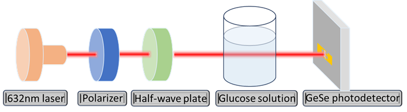
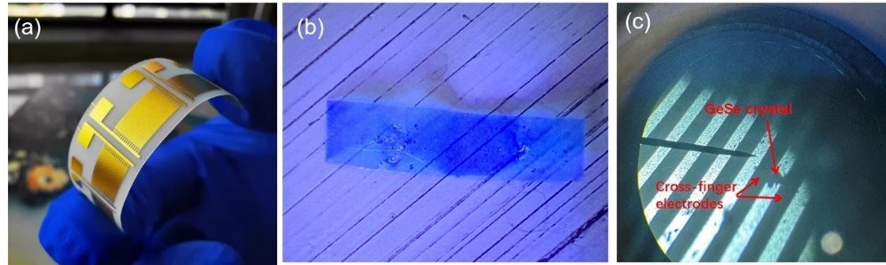
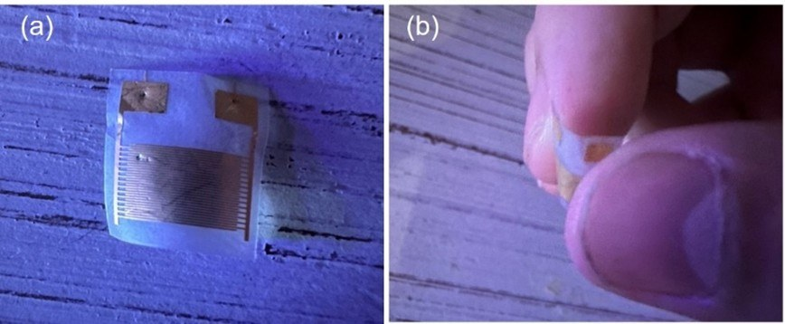
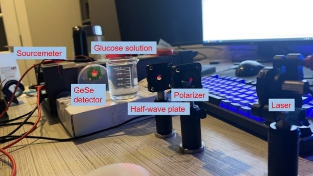
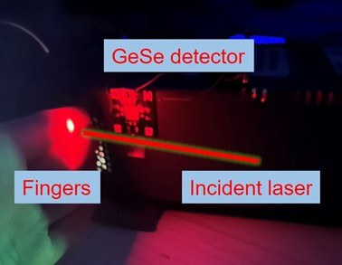
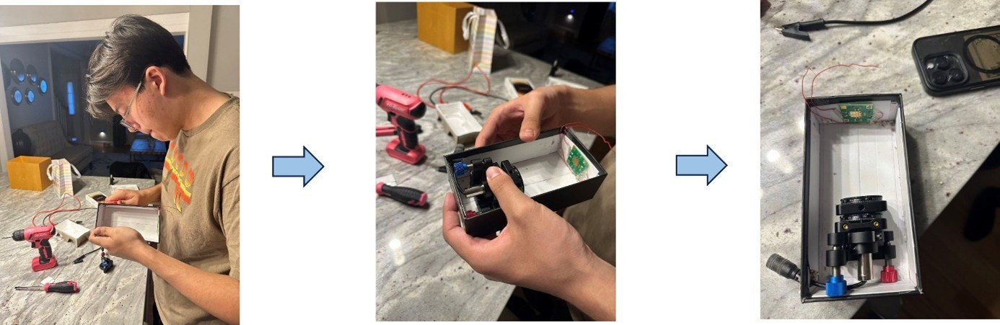
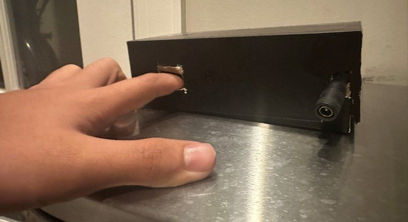

# VitaSensor

**Lab-stage development of a needle-free, wearable glucose sensor**

[](https://www.thevitasensor.com)
[]()
<!-- TODO: add verified Google Patents or USPTO public document URL for application 19/203,391. No public page was found as of 2026-11-10. -->

VitaSensor is a biomedical startup developing a needle-free, wearable glucose sensor. The work is currently at the laboratory stage, on its **third-generation lab prototype**.

## Technology

The platform uses **flexible GeSe-based nanomaterial biosensors** combined with optical polarimetry and machine learning calibration.

### Key Technical Achievements

- **Accuracy (lab benchmark):** R² = 0.94, MAE ≈ 8.6 mg/dL
- **Architecture:** Polarizer-free chiroptical biosensing using in-plane anisotropy of 2D GeSe
- **ML Pipeline:** Custom calibration model for glucose prediction from optical signals
- **Form Factor:** Flexible, wearable design (lab prototype)
- **Current stage:** Third-generation lab prototype

## Figures

Photographs and the optical-train schematic below are from [maxkopptech.com/glucose-monitoring](https://maxkopptech.com/glucose-monitoring/) and the site’s [Glucose Monitoring gallery](https://maxkopptech.com/pgc_simply_gallery/glucose-monitoring/). They document the laboratory-stage GeSe / polarimetry prototype. Fingertip photographs are noninvasive self-tests, not a clinical study. Concept renderings that showed a mock 110 mg/dL reading were not included.



*Schematic of the laboratory optical train, labeled on the figure: 632 nm laser, polarizer, half-wave plate, glucose solution, and GeSe photodetector.*



*Laboratory photographs labeled (a) a flexible gold electrode array, (b) a film on a substrate, and (c) a microscope view marked “GeSe crystal” and “Cross-finger electrodes.”*



*(a) A small interdigitated electrode device on tape. (b) A fingertip holding a small flexible sensor. Laboratory / self-test photographs; noninvasive fingertip use.*



*Labeled laboratory bench: sourcemeter, GeSe detector, a beaker marked “Glucose solution,” half-wave plate, polarizer, and laser.*



*Photograph of a noninvasive fingertip self-test in the laboratory, labeled “Fingers,” “Incident laser,” and “GeSe detector.”*



*Three-panel photograph of a portable enclosure being assembled, with optical mounts and a small circuit board inside a black box.*



*A finger placed in the slot of a black boxed laboratory prototype that also has a barrel power connector. Laboratory / self-test photograph.*

## Intellectual Property

| Filing | Title | Status |
|--------|-------|--------|
| U.S. Utility Application 19/203,391 | Non-Invasive Health Monitoring Device | Filed May 2025 (published utility application) |
| U.S. Provisional Application 63/726,463 | Non-Invasive Health Monitoring Device | Filed |
| U.S. Provisional Application 63/775,901 | Inkjet-Printed Ultrasonic Sensor for SHM | Filed |

## Publications

1. M. B. Kopp, "Flexible nanomaterial sensors for non-invasive health monitoring," *Applied and Computational Engineering*, vol. 72, pp. 45–58, 2024. [doi:10.54254/2755-2721/72/20240981](https://doi.org/10.54254/2755-2721/72/20240981)
2. M. B. Kopp, "Next-generation polarimetric biosensors: machine learning–driven GeSe photodetectors for noninvasive glucose monitoring," *Biosensors and Bioelectronics: X*, vol. 28, art. 100725, 2025 (sole author). [doi:10.1016/j.biosx.2025.100725](https://doi.org/10.1016/j.biosx.2025.100725)

## Recognition

- Conrad Challenge National Finalist (2025)
- MIT Solve Global Health Challenge Semifinalist (2025)
- Global Youth Entrepreneurship Challenge Most Innovative Project (2024)

## Repository Structure

```
vitasensor/
├── figures/            # Laboratory photographs, prototype photos, and optical-train schematic
├── docs/               # Technical documentation and architecture
├── README.md
└── LICENSE
```

> **Note:** Core algorithms and hardware designs are proprietary and protected under U.S. patent applications. This repository contains project documentation and public-facing materials.

## Contact

- **Website:** [thevitasensor.com](https://www.thevitasensor.com)
- **Founder:** Maximilian Kopp — [maxkopp2007@gmail.com](mailto:maxkopp2007@gmail.com) | [maxkopptech.com](https://www.maxkopptech.com) | [LinkedIn](https://www.linkedin.com/in/maxkopp)
